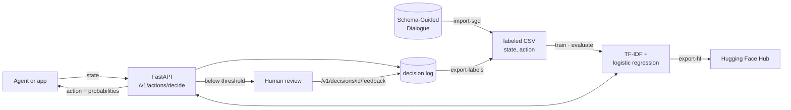
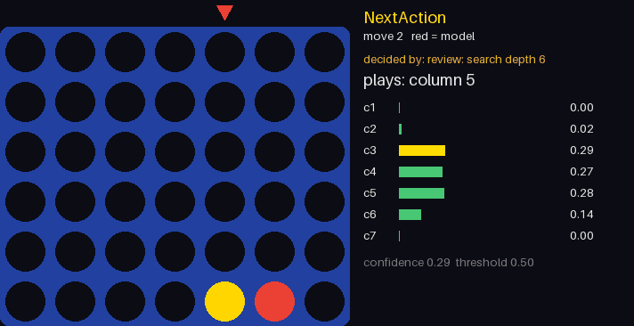

# NextAction

**A small, auditable next-action model for AI agents.** Given the current state of a conversation, NextAction predicts what the agent should do next (ask, search, present options, confirm, execute, end the conversation) with a probability for every action and a threshold that sends uncertain cases to a human. It speaks **English and Portuguese**.

[](https://github.com/leduardoaraujo/NextAction/actions/workflows/ci.yml)


[](LICENSE)

> Formerly named OpenDecision. Renamed to NextAction to avoid confusion with an unrelated project of the same name.

*Leia em português: [README.pt-BR.md](README.pt-BR.md)* · Models on the Hub: [nextaction-agent](https://huggingface.co/ludolua/nextaction-agent), [nextaction-flights](https://huggingface.co/ludolua/nextaction-flights)

```text
state  →  [intent SearchOnewayFlight] [filled origin_airport] [missing destination_airport departure_date]
          || user: I need a flight from Boston.
action →  ask (0.99)   ✓ automatic, above the 0.9 review threshold
```

## Why

LLM agents rarely fail at writing sentences; they fail at **control flow**: searching before they know the destination, booking without confirmation, answering when they should ask. NextAction isolates that decision into a model that is:

- **Explicit**: one fixed action vocabulary, so every choice can be logged, counted and tested.
- **Policy-driven**: per-action thresholds, risk levels, error costs and state rules decide what is automated, what is blocked and what goes to review, all set in one TOML file per scenario.
- **Improvable from use**: every API decision gets an id; corrections sent back become training data.
- **Cheap**: TF-IDF + logistic regression. Trains on a laptop, predicts in milliseconds, ships as a 5 MB file.

The interface (state in, one defined action out, with probabilities) is inspired by [Jev's System One models](https://typesafe.ai/blog/introducing-system-one-models-and-jev). This project does not reproduce Jev's architecture or its RLCD training.

## Results

The generic `agent` model is trained on the [Schema-Guided Dialogue](https://github.com/google-research-datasets/dstc8-schema-guided-dialogue) dataset (165k assistant turns, 20 domains) and evaluated on its official test split, which includes **services never seen during training** (42k turns).

| Input | Accuracy | Automated at 0.9 threshold | Accuracy when automated |
| --- | --- | --- | --- |
| Conversation + dialogue state | **0.90** | 50.0% | **99.6%** |
| Conversation only¹ | 0.77 | 28.9% | 96.8% |
| Always the most frequent action | 0.21 | | |

¹ Ablation run with the full vocabulary (`min_df=1`); the published model uses `min_df=5` and is 4.7 MB.

Adding the dialogue state (which required fields are still missing) is what moves the needle: F1 for `ask` goes from 0.71 to 0.97. Full per-action metrics, calibration and threshold curves are in [docs/sgd-model.md](docs/sgd-model.md).

## How it works



1. **Data**: labeled `state,action` pairs, either written by hand, imported from public dialogue data or exported from real decisions with feedback.
2. **Evaluation first**: `evaluate` reports per-action errors, the confusion matrix, calibration error and how many decisions each threshold would automate, compared against a majority-class baseline.
3. **Serving**: a FastAPI service returns the action, the probabilities and `needs_review`. A typed Rust CLI consumes the same contract.
4. **Learning loop**: decisions and corrections are appended to a JSONL log and turned back into training data in chronological order.
5. **Publishing**: models are exported in the safe [skops](https://skops.readthedocs.io/) format (no pickle) with a generated model card.

## Quickstart

```bash
python -m venv .venv
source .venv/bin/activate            # Windows: .venv\Scripts\activate
pip install -e ".[api]"

nextaction train flights
nextaction decide flights "Tenho origem GRU destino REC ida 12/11 e ainda não consultei voos"
```

```json
{
  "type": "choice",
  "action": "search",
  "probabilities": { "ask": 0.2085, "confirm": 0.183, "present_options": 0.1922, "search": 0.4163 },
  "needs_review": true,
  "requires_confirmation": false,
  "risk": "low",
  "threshold": 0.7,
  "reasons": ["below_threshold"],
  "blocked_actions": []
}
```

The bundled scenarios are tiny and synthetic, so the model is unsure and asks for review. To train the generic model on real dialogues, follow [docs/sgd-model.md](docs/sgd-model.md). To serve it over HTTP:

```bash
uvicorn nextaction.api:app --reload    # then open http://127.0.0.1:8000/docs
```

## English and Portuguese

English is the canonical language of the code and the contracts; Portuguese is accepted everywhere as a permanent alias.

| | English | Portuguese alias |
| --- | --- | --- |
| CLI commands | `train`, `decide`, `evaluate`, `rank-flights`… | `treinar`, `decidir`, `avaliar`, `avaliar-passagens`… |
| CLI options | `--data`, `--model`, `--threshold` | `--dados`, `--modelo`, `--limiar` |
| Scenarios | `agent`, `flights`, `research` | `agente`, `passagens`, `pesquisa` |
| API fields | `scenario`, `state`, `threshold`, `final_action` | `cenario`, `estado`, `limiar`, `acao_final` |
| Actions | `ask`, `search`, `confirm`… | `perguntar`, `buscar`, `confirmar`… |
| CSV columns | `state,action` | `estado,acao` |
| State tags | `[intent] [filled] [missing] [requested]`, `user:` | `[intencao] [preenchidos] [faltando] [pedidos]`, `usuario:` |

Responses always use the English names. Human-readable messages (errors, warnings, help) follow `--lang pt`, `NEXTACTION_LANG=pt` or the `Accept-Language: pt-BR` header. Details are in [docs/api.md](docs/api.md#languages).

## Demos

Two games where the model makes every decision on screen: the probability of each move, the moves the policy blocked, and the moments it hands the move to a reviewer because it is unsure.

| Pac-Man | Connect Four |
| --- | --- |
|  |  |
| Imitates a rule-based expert and matches it on 300 unseen games (39–40% wins against 35%), asking for help on 3.3% of moves. Reviewing more often does not win more, because the expert is no stronger than the model. [Demo, error analysis](demos/pacman/README.md) | Imitates a depth-4 search. Alone it wins 19%; with unsure moves reviewed by a deeper search it wins 40%, at its teacher's level, and a stronger reviewer beats an equal one by 13 wins in 200 games. [Demo](demos/connect4/README.md) |

Together they show when human-in-the-loop review pays off: when the reviewer knows more than the model. Each demo folder has the scripts to regenerate the data, watch any agent play live, record the GIF and rerun the benchmark.

## Features

| | |
| --- | --- |
| **Scenarios** | `agent` (generic, real dialogues), `flights` (flight booking), `research` (research agent) |
| **CLI** | `train`, `decide`, `evaluate`, `tune`, `calibrate-policy`, `import-sgd`, `export-labels`, `export-hf`, `rank-flights`, `jobs` |
| **REST API** | decide, feedback, flight-offer ranking, model status, jobs; OpenAPI docs at `/docs` |
| **Progress tracking** | progress bars in the terminal, `nextaction jobs --watch` and a live web dashboard at `/dashboard` |
| **Decision policy** | per-action thresholds calibrated from error costs, risk levels, confirmation for irreversible actions, rules that block impossible actions ([docs/policy.md](docs/policy.md)) |
| **Tuning** | `nextaction tune` searches the hyperparameter grid in the scenario config |
| **Evaluation** | cross-validation, separate test set or most-recent slice; per-action F1, confusion matrix, ECE, threshold table |
| **Rule-based ranker** | filters and ranks flight offers by budget, baggage, stops, price and duration, with explanations |
| **Demos** | Pac-Man and Connect Four played by the model, with a live decision panel, GIF recording and benchmarks |
| **Clients** | typed Rust CLI (`clients/rust`) |
| **Distribution** | skops export with a generated model card and the decision policy, published on the [Hugging Face Hub](https://huggingface.co/ludolua/nextaction-agent) |

## Testing

Two kinds of evidence back this project: **software tests** that check every contract, and **model evaluations** on data the model never saw.

### Software tests

**71 tests, all passing, 88% coverage** (lines and branches). CI runs them on Python 3.12 and 3.13 for every push and pull request, builds the Rust client, and publishes the full report in each run's summary on the [Actions tab](https://github.com/leduardoaraujo/NextAction/actions/workflows/ci.yml).

| Suite | Tests | What it verifies |
| --- | --- | --- |
| [`test_api`](tests/test_api.py) | 12 | REST contracts in English and with Portuguese fields, feedback loop, localized errors, flight ranking |
| [`test_policy`](tests/test_policy.py) | 10 | rule masking, per-action thresholds, irreversible actions, cost-based calibration, tuning written back to TOML |
| [`test_pacman_demo`](tests/test_pacman_demo.py) | 5 | deterministic games, walls and scoring, state tags, `deny_tag` rules, the Pac-Man config |
| [`test_connect4_demo`](tests/test_connect4_demo.py) | 5 | win detection, search takes wins and blocks threats, alpha-beta equals minimax, blocked and gifted columns |
| [`test_flights`](tests/test_flights.py) | 7 | rule-based offer filtering and ranking, validation errors in both languages |
| [`test_progress`](tests/test_progress.py) | 7 | job files, stale jobs, `jobs` command, `/v1/jobs` and the dashboard |
| [`test_cli`](tests/test_cli.py) | 6 | English commands, Portuguese aliases, `--lang` and `NEXTACTION_LANG` |
| [`test_vocabulary`](tests/test_vocabulary.py) | 6 | action and state normalization, Portuguese CSVs, models trained with Portuguese labels |
| [`test_evaluation`](tests/test_evaluation.py) | 5 | cross-validation, recent-slice testing, threshold table, localized report |
| [`test_sgd`](tests/test_sgd.py) | 4 | SGD act mapping, missing-slot state, flights schema |
| [`test_decision_log`](tests/test_decision_log.py) | 2 | append-only log, latest feedback wins, label export |
| [`test_hub`](tests/test_hub.py) | 2 | skops export loads safely, model card metadata |

Every test with its result and duration, and coverage per module, are in **[docs/testing.md](docs/testing.md)**. To reproduce:

```bash
pip install -e ".[dev]"
python -m unittest discover -s tests                     # run the suite
python scripts/test_report.py --output docs/testing.md   # suite + coverage report
```

### Model evaluation

Model claims in this README are measured, not estimated. Each number comes from a held-out split and can be regenerated with one command:

| Claim | Evidence | Reproduce |
| --- | --- | --- |
| 0.90 accuracy on services never seen in training | official SGD test split, 42,297 turns | `nextaction evaluate agent` |
| Dialogue state lifts accuracy from 0.77 to 0.90 | ablation with and without state tags | [docs/sgd-model.md](docs/sgd-model.md#ablation-does-the-dialogue-state-matter) |
| Calibrated policy lowers expected cost by 12% | thresholds fitted on the dev split, scored on test | `nextaction calibrate-policy agent`, then `evaluate agent` ([docs/policy.md](docs/policy.md#results-on-the-sgd-test-split)) |
| The small bundled scenarios are not reliable | cross-validation gives 0.50 on 48 examples | `nextaction evaluate flights` |

## Repository layout

```text
nextaction/
  vocabulary.py    canonical actions and state format, with Portuguese aliases
  scenarios.py     loads configs/<scenario>.toml: data, model parameters, tuning grid, policy
  policy.py        decision policy: rules, per-action thresholds, risk, cost-based calibration
  tuning.py        hyperparameter search and policy calibration, written back to the config
  i18n.py          English and Portuguese messages
  progress.py      job progress: terminal bars and jobs/<id>.json for the CLI and dashboard
  model.py         training and inference (TF-IDF + logistic regression)
  evaluation.py    evaluation report: per-action metrics, calibration, thresholds
  sgd.py           Schema-Guided Dialogue → state,action converter
  decision_log.py  append-only decision log and feedback export
  api.py           FastAPI service · schemas.py: request and response contracts
  hub.py           skops export and model card generation
  flights.py       rule-based flight offer filter and ranker
  cli.py           command line entry point
clients/rust/      Rust client for the REST API
configs/           one TOML file per scenario
data/              bundled synthetic examples (external data goes to data/external/, git-ignored)
docs/              detailed documentation
demos/pacman/      Pac-Man demo: game, expert, data generation, live view, GIF, benchmark, error analysis
demos/connect4/    Connect Four demo: board, alpha-beta search, data generation, live view, GIF, benchmark
scripts/           test report and one-off data tools
tests/             test suites (see Testing)
```

## Documentation

- [Generic agent model on Schema-Guided Dialogue](docs/sgd-model.md): data mapping, state format, results, ablation
- [Scenario configs and decision policy](docs/policy.md): rules, thresholds, error costs, tuning
- [Evaluation](docs/evaluation.md): what each metric means and how to choose a threshold
- [Test report](docs/testing.md): every test with its result, duration and coverage per module
- [REST API, feedback loop, languages and Rust client](docs/api.md)
- [Tracking progress](docs/progress.md): terminal bars, `jobs --watch` and the web dashboard
- [Publishing to Hugging Face](docs/hugging-face.md)
- [Flight booking scenario](docs/scenarios/flights.md)

## Limitations

- The model matches word patterns. It does not verify facts or enforce business rules; the calling app must check preconditions before acting.
- Probabilities are not calibrated (expected calibration error ≈ 0.08 on SGD). Pick thresholds from the evaluation table, not from intuition.
- SGD conversations were written by crowd workers from simulated scripts, so real users will be messier. Measure on your own logged decisions before automating.
- The `agent` model is trained on English text; the Portuguese scenarios use small synthetic datasets for demonstration.
- Never execute irreversible actions (payments, bookings) from a prediction alone.

## Roadmap

- [ ] One model for Portuguese and English states (multilingual embeddings or translated training data)
- [x] Thresholds tuned to error costs and rules that mask actions per state ([docs/policy.md](docs/policy.md))
- [ ] Learning from outcomes (contextual bandits) once enough feedback is logged

## License and data

Code: [MIT](LICENSE). The Schema-Guided Dialogue dataset is © Google, released under [CC BY-SA 4.0](https://creativecommons.org/licenses/by-sa/4.0/), and is not redistributed here; models trained on it are published under the same license. If you use the dataset, cite Rastogi et al., *Towards Scalable Multi-domain Conversational Agents: The Schema-Guided Dialogue Dataset* (AAAI 2020).
