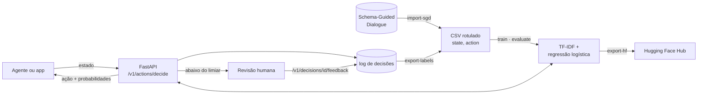

# NextAction

**Um modelo pequeno e auditável que decide a próxima ação de agentes de IA.** A partir do estado atual de uma conversa, o NextAction prevê o que o agente deve fazer em seguida (perguntar, buscar, apresentar opções, confirmar, executar, encerrar a conversa), com a probabilidade de cada ação e um limiar que manda os casos incertos para uma pessoa. Funciona em **inglês e português**.

[](https://github.com/leduardoaraujo/NextAction/actions/workflows/ci.yml)


[](LICENSE)

> Antes se chamava OpenDecision. Mudou para NextAction para não ser confundido com outro projeto, sem relação, de mesmo nome.

*Read in English: [README.md](README.md)* · **[Site com a documentação](https://leduardoaraujo.github.io/NextAction/)** · Modelos no Hub: [nextaction-agent](https://huggingface.co/ludolua/nextaction-agent), [nextaction-flights](https://huggingface.co/ludolua/nextaction-flights), [nextaction-pacman](https://huggingface.co/ludolua/nextaction-pacman), [nextaction-connect4](https://huggingface.co/ludolua/nextaction-connect4)

```text
state  →  [intent SearchOnewayFlight] [filled origin_airport] [missing destination_airport departure_date]
          || user: I need a flight from Boston.
action →  ask (0.99)   ✓ automatic, above the 0.9 review threshold
```

## Por quê

Agentes com LLM raramente erram ao escrever frases. Eles erram no **controle de fluxo**: buscam antes de saber o destino, reservam sem confirmação, respondem quando deveriam perguntar. O NextAction isola essa decisão num modelo que é:

- **Explícito**: um vocabulário fixo de ações, para que cada escolha possa ser registrada, contada e testada.
- **Guiado por política**: limiares por ação, níveis de risco, custos de erro e regras de estado decidem o que é automatizado, o que é bloqueado e o que vai para revisão, tudo definido em um arquivo TOML por cenário.
- **Melhorado pelo uso**: cada decisão da API recebe um id; as correções enviadas de volta viram dados de treino.
- **Barato**: TF-IDF + regressão logística. Treina num notebook, prevê em milissegundos e é distribuído como um arquivo de 5 MB.

A interface (estado na entrada, uma ação definida na saída, com probabilidades) é inspirada nos [modelos System One do Jev](https://typesafe.ai/blog/introducing-system-one-models-and-jev). Este projeto não reproduz a arquitetura do Jev nem o seu treinamento RLCD.

## Resultados

O modelo genérico `agent` foi treinado com o conjunto de dados [Schema-Guided Dialogue](https://github.com/google-research-datasets/dstc8-schema-guided-dialogue) (165 mil turnos de assistente, 20 domínios) e avaliado no seu split de teste oficial, que inclui **serviços que nunca aparecem no treino** (42 mil turnos).

| Entrada | Acurácia | Automáticas com limiar 0,9 | Acurácia nas automáticas |
| --- | --- | --- | --- |
| Conversa + estado do diálogo | **0,90** | 50,0% | **99,6%** |
| Só a conversa¹ | 0,77 | 28,9% | 96,8% |
| Sempre a ação mais frequente | 0,21 | | |

¹ Ablação feita com o vocabulário completo (`min_df=1`); o modelo publicado usa `min_df=5` e tem 4,7 MB.

Acrescentar o estado do diálogo (quais campos obrigatórios ainda faltam) é o que faz a diferença: o F1 de `ask` sobe de 0,71 para 0,97. As métricas completas por ação, a calibração e as curvas de limiar estão em [docs/sgd-model.md](docs/sgd-model.md).

## Como funciona



1. **Dados**: pares `state,action` rotulados, escritos à mão, importados de dados públicos de diálogo ou exportados de decisões reais com feedback.
2. **Avaliação primeiro**: `evaluate` informa os erros por ação, a matriz de confusão, o erro de calibração e quantas decisões cada limiar automatizaria, comparando com uma linha de base que sempre escolhe a classe majoritária.
3. **Serviço**: um serviço FastAPI retorna a ação, as probabilidades e `needs_review`. Uma CLI tipada em Rust consome o mesmo contrato.
4. **Ciclo de aprendizado**: decisões e correções são acrescentadas a um log JSONL e voltam a ser dados de treino em ordem cronológica.
5. **Publicação**: os modelos são exportados no formato seguro [skops](https://skops.readthedocs.io/) (sem pickle), com um model card gerado automaticamente.

## Começo rápido

```bash
python -m venv .venv
source .venv/bin/activate            # Windows: .venv\Scripts\activate
pip install -e ".[api]"

nextaction train flights
nextaction decide flights "Tenho origem GRU destino REC ida 12/11 e ainda não consultei voos"
```

```json
{
  "type": "choice",
  "action": "search",
  "probabilities": { "ask": 0.2085, "confirm": 0.183, "present_options": 0.1922, "search": 0.4163 },
  "needs_review": true,
  "requires_confirmation": false,
  "risk": "low",
  "threshold": 0.7,
  "reasons": ["below_threshold"],
  "blocked_actions": []
}
```

Os cenários incluídos são pequenos e sintéticos, então o modelo fica inseguro e pede revisão. Para treinar o modelo genérico com diálogos reais, siga [docs/sgd-model.md](docs/sgd-model.md). Para servi-lo via HTTP:

```bash
uvicorn nextaction.api:app --reload    # then open http://127.0.0.1:8000/docs
```

## Inglês e português

O inglês é o idioma canônico do código e dos contratos; o português é aceito em todo lugar como sinônimo permanente.

| | Inglês | Sinônimo em português |
| --- | --- | --- |
| Comandos da CLI | `train`, `decide`, `evaluate`, `rank-flights`… | `treinar`, `decidir`, `avaliar`, `avaliar-passagens`… |
| Opções da CLI | `--data`, `--model`, `--threshold` | `--dados`, `--modelo`, `--limiar` |
| Cenários | `agent`, `flights`, `research` | `agente`, `passagens`, `pesquisa` |
| Campos da API | `scenario`, `state`, `threshold`, `final_action` | `cenario`, `estado`, `limiar`, `acao_final` |
| Ações | `ask`, `search`, `confirm`… | `perguntar`, `buscar`, `confirmar`… |
| Colunas do CSV | `state,action` | `estado,acao` |
| Tags de estado | `[intent] [filled] [missing] [requested]`, `user:` | `[intencao] [preenchidos] [faltando] [pedidos]`, `usuario:` |

As respostas usam sempre os nomes em inglês. As mensagens para pessoas (erros, avisos e ajuda) seguem `--lang pt`, `NEXTACTION_LANG=pt` ou o header `Accept-Language: pt-BR`. Os detalhes estão em [docs/api.md](docs/api.md#languages).

## Demos

Pac-Man e Connect Four (Lig 4) mostram as probabilidades de cada jogada, as escolhas bloqueadas e as decisões de revisão. Doom mostra o modelo se movendo e lutando no ViZDoom.

| Pac-Man | Lig 4 |
| --- | --- |
|  |  |
| Imita um especialista baseado em regras e empata com ele em 300 partidas inéditas (39–40% de vitórias, contra 35%), pedindo ajuda em 3,3% das jogadas. Revisar com mais frequência não aumenta as vitórias, porque o especialista não é mais forte que o modelo. [Demo, análise de erros](demos/pacman/README.md) | Imita uma busca de profundidade 4. Sozinho, vence 19%; com as jogadas inseguras revisadas por uma busca mais profunda, vence 40%, no nível do seu professor, e um revisor mais forte supera um revisor equivalente por 13 vitórias em 200 partidas. [Demo](demos/connect4/README.md) |

Juntos, eles mostram quando a revisão humana compensa: quando quem revisa sabe mais que o modelo. As pastas incluem scripts para regenerar os dados, ver os agentes jogando, gravar GIFs e rodar de novo os benchmarks.

**Doom:** O [demo com ViZDoom](demos/doom/README.md) treina com as decisões de um jogador baseado em regras numa arena Deathmatch e depois grava movimentação, combates e probabilidades de decisão num [GIF](demos/doom/doom.gif). Requer `vizdoom>=1.3`.

**Imagens:** `nextaction inspect-image photo.jpg` detecta pessoas, animais e outros objetos, salva uma cópia anotada e retorna contagens e caixas em JSON. Veja o [guia de detecção em imagens](docs/scenarios/images.md). Instale com `pip install -e ".[vision]"`.

## Funcionalidades

| | |
| --- | --- |
| **Cenários** | `agent` (genérico, diálogos reais), `flights` (reserva de passagens aéreas), `research` (agente de pesquisa) |
| **CLI** | `train`, `decide`, `evaluate`, `tune`, `calibrate-policy`, `import-sgd`, `export-labels`, `export-hf`, `rank-flights`, `jobs` |
| **API REST** | decisão, feedback, ranking de ofertas de voo, status do modelo, jobs; documentação OpenAPI em `/docs` |
| **Acompanhamento de progresso** | barras de progresso no terminal, `nextaction jobs --watch` e um painel web ao vivo em `/dashboard` |
| **Política de decisão** | limiares por ação calibrados a partir dos custos de erro, níveis de risco, confirmação para ações irreversíveis, regras que bloqueiam ações impossíveis ([docs/policy.md](docs/policy.md)) |
| **Ajuste** | `nextaction tune` percorre a grade de hiperparâmetros definida na configuração do cenário |
| **Avaliação** | validação cruzada, conjunto de teste separado ou fatia mais recente; F1 por ação, matriz de confusão, ECE, tabela de limiares |
| **Ranqueador baseado em regras** | filtra e ordena ofertas de voo por orçamento, bagagem, escalas, preço e duração, com explicações |
| **Demos** | partidas de Pac-Man, Lig 4 e Doom; detecção de objetos em imagens com saída anotada |
| **Clientes** | CLI tipada em Rust (`clients/rust`) |
| **Distribuição** | exportação skops com model card gerado e a política de decisão, publicada no [Hugging Face Hub](https://huggingface.co/ludolua/nextaction-agent) |

## Testes

Dois tipos de evidência sustentam este projeto: **testes de software**, que verificam cada contrato, e **avaliações do modelo** em dados que ele nunca viu.

### Testes de software

**77 testes, todos passando, 84% de cobertura** (linhas e ramificações). O CI roda a suíte no Python 3.12 e 3.13 a cada push e pull request, compila o cliente Rust e publica o relatório completo no resumo de cada execução, na [aba Actions](https://github.com/leduardoaraujo/NextAction/actions/workflows/ci.yml).

| Suíte | Testes | O que verifica |
| --- | --- | --- |
| [`test_api`](tests/test_api.py) | 12 | contratos REST em inglês e com campos em português, ciclo de feedback, erros localizados, ranking de voos |
| [`test_policy`](tests/test_policy.py) | 10 | mascaramento por regras, limiares por ação, ações irreversíveis sempre revisadas, calibração por custo, ajuste gravado de volta no TOML |
| [`test_pacman_demo`](tests/test_pacman_demo.py) | 5 | partidas determinísticas, paredes e pontuação, tags de estado, regras `deny_tag`, a configuração do Pac-Man |
| [`test_connect4_demo`](tests/test_connect4_demo.py) | 5 | detecção de vitória, a busca aproveita vitórias e bloqueia ameaças, alpha-beta igual ao minimax, colunas bloqueadas e entregues ao adversário |
| [`test_flights`](tests/test_flights.py) | 7 | filtragem e ranking de ofertas baseados em regras, erros de validação nos dois idiomas |
| [`test_progress`](tests/test_progress.py) | 7 | arquivos de job, jobs parados, comando `jobs`, `/v1/jobs` e o painel |
| [`test_cli`](tests/test_cli.py) | 6 | comandos em inglês, sinônimos em português, `--lang` e `NEXTACTION_LANG` |
| [`test_vocabulary`](tests/test_vocabulary.py) | 6 | normalização de ações e estados, CSVs em português, modelos treinados com rótulos em português |
| [`test_evaluation`](tests/test_evaluation.py) | 5 | validação cruzada, teste na fatia recente, tabela de limiares, relatório localizado |
| [`test_sgd`](tests/test_sgd.py) | 4 | mapeamento dos atos do SGD, estado com campos faltando, esquema de passagens |
| [`test_decision_log`](tests/test_decision_log.py) | 2 | log só de acréscimo, o feedback mais recente prevalece, exportação de rótulos |
| [`test_hub`](tests/test_hub.py) | 2 | a exportação skops carrega com segurança, metadados do model card |
| [`test_orchestrator_demo`](tests/test_orchestrator_demo.py) | 4 | dados sintéticos de orquestração, contratos de política e de benchmark |
| [`test_bandit`](tests/test_bandit.py) | 2 | o feedback de resultado exige ação, recompensa e propensão; o candidato bandit fica fora do serviço |

Cada teste com seu resultado e duração, e a cobertura por módulo, estão em **[docs/testing.md](docs/testing.md)**. Para reproduzir:

```bash
pip install -e ".[dev]"
python -m unittest discover -s tests                     # run the suite
python scripts/test_report.py --output docs/testing.md   # suite + coverage report
```

### Avaliação do modelo

Os números do modelo neste README são medidos, não estimados. Cada número vem de um conjunto separado e pode ser regenerado com um comando:

| Afirmação | Evidência | Como reproduzir |
| --- | --- | --- |
| Acurácia de 0,90 em serviços nunca vistos no treino | split de teste oficial do SGD, 42.297 turnos | `nextaction evaluate agent` |
| O estado do diálogo eleva a acurácia de 0,77 para 0,90 | ablação com e sem as tags de estado | [docs/sgd-model.md](docs/sgd-model.md#ablation-does-the-dialogue-state-matter) |
| A política calibrada reduz o custo esperado em 12% | limiares ajustados no split de desenvolvimento, medidos no de teste | `nextaction calibrate-policy agent`, depois `evaluate agent` ([docs/policy.md](docs/policy.md#results-on-the-sgd-test-split)) |
| Os pequenos cenários incluídos não são confiáveis | a validação cruzada dá 0,50 em 48 exemplos | `nextaction evaluate flights` |

## Estrutura do repositório

```text
nextaction/
  vocabulary.py    canonical actions and state format, with Portuguese aliases
  scenarios.py     loads configs/<scenario>.toml: data, model parameters, tuning grid, policy
  policy.py        decision policy: rules, per-action thresholds, risk, cost-based calibration
  tuning.py        hyperparameter search and policy calibration, written back to the config
  i18n.py          English and Portuguese messages
  progress.py      job progress: terminal bars and jobs/<id>.json for the CLI and dashboard
  model.py         training and inference (TF-IDF + logistic regression)
  evaluation.py    evaluation report: per-action metrics, calibration, thresholds
  sgd.py           Schema-Guided Dialogue → state,action converter
  decision_log.py  append-only decision log and feedback export
  api.py           FastAPI service · schemas.py: request and response contracts
  hub.py           skops export and model card generation
  flights.py       rule-based flight offer filter and ranker
  cli.py           command line entry point
clients/rust/      Rust client for the REST API
configs/           one TOML file per scenario
data/              bundled synthetic examples (external data goes to data/external/, git-ignored)
docs/              detailed documentation
demos/pacman/      Pac-Man demo: game, expert, data generation, live view, GIF, benchmark, error analysis
demos/connect4/    Connect Four demo: board, alpha-beta search, data generation, live view, GIF, benchmark
scripts/           test report and one-off data tools
tests/             test suites (see Testing)
```

## Documentação

- [Modelo genérico de agente com o Schema-Guided Dialogue](docs/sgd-model.md): mapeamento dos dados, formato do estado, resultados, ablação
- [Configurações de cenário e política de decisão](docs/policy.md): regras, limiares, custos de erro, ajuste
- [Avaliação](docs/evaluation.md): o que cada métrica significa e como escolher um limiar
- [Relatório de testes](docs/testing.md): cada teste com seu resultado, duração e cobertura por módulo
- [API REST, ciclo de feedback, idiomas e cliente Rust](docs/api.md)
- [Acompanhamento de progresso](docs/progress.md): barras no terminal, `jobs --watch` e o painel web
- [Modelo bilíngue e aprendizado com resultados](docs/outcomes.md)
- [Publicação no Hugging Face](docs/hugging-face.md)
- [Cenário de reserva de passagens aéreas](docs/scenarios/flights.md)

## Limitações

- O modelo reconhece padrões de palavras. Ele não verifica fatos nem aplica regras de negócio; a aplicação que o chama deve checar as pré-condições antes de agir.
- As probabilidades não são calibradas (erro de calibração esperado ≈ 0,08 no SGD). Escolha os limiares pela tabela de avaliação, não pela intuição.
- As conversas do SGD foram escritas por trabalhadores de crowdsourcing a partir de roteiros simulados, então usuários reais serão mais confusos. Meça nas suas próprias decisões registradas antes de automatizar.
- O modelo `agent` original é treinado com texto em inglês. O `agent_bilingual` acrescenta diálogos de treino do SGD traduzidos para o português; o resultado no teste traduzido não comprova o desempenho com usuários reais em português.
- Nunca execute ações irreversíveis (pagamentos, reservas) só com base numa previsão.

## Roadmap

- [x] Um único modelo para estados em português e inglês usando dados de treino traduzidos ([avaliação e reprodução](docs/outcomes.md))
- [x] Limiares ajustados aos custos de erro e regras que mascaram ações conforme o estado ([docs/policy.md](docs/policy.md))
- [x] Registro de resultados e um fluxo offline de candidato com contextual bandit ([guia](docs/outcomes.md)); o uso em produção aguarda dados reais de resultados e revisão

## Licença e dados

Código: [MIT](LICENSE). O conjunto de dados Schema-Guided Dialogue é © Google, publicado sob [CC BY-SA 4.0](https://creativecommons.org/licenses/by-sa/4.0/), e não é redistribuído aqui; os modelos treinados com ele são publicados sob a mesma licença. Se usar o conjunto de dados, cite Rastogi et al., *Towards Scalable Multi-domain Conversational Agents: The Schema-Guided Dialogue Dataset* (AAAI 2020).
