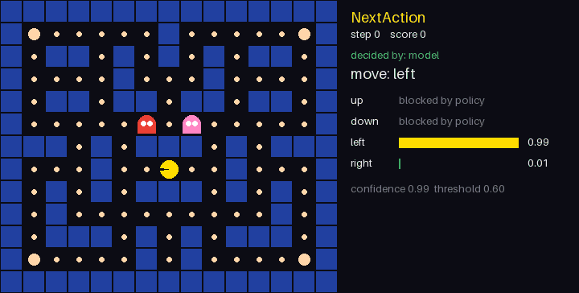

# NextAction

> Antes se chamava OpenDecision. Mudou para NextAction para não ser confundido com outro projeto de mesmo nome.

*Read in English: [README.md](README.md)* · Modelos no Hugging Face: [nextaction-agent](https://huggingface.co/ludolua/nextaction-agent), [nextaction-flights](https://huggingface.co/ludolua/nextaction-flights)

**Um modelo pequeno e auditável que decide a próxima ação de agentes de IA.** A partir do estado atual de uma conversa, o NextAction prevê o que o agente deve fazer em seguida (perguntar, buscar, apresentar opções, confirmar, executar, encerrar). Cada previsão vem com a probabilidade de cada ação e um limiar que manda os casos incertos para revisão humana. Funciona em **inglês e português**.

```text
estado →  [intencao SearchOnewayFlight] [preenchidos origin_airport] [faltando destination_airport departure_date]
          || usuario: Preciso de um voo saindo de Boston.
ação   →  ask (perguntar)   ✓ automática, acima do limiar de revisão
```

## Por quê

Agentes com LLM raramente erram ao escrever frases. Eles erram no **controle de fluxo**: buscam antes de saber o destino, reservam sem confirmação, respondem quando deveriam perguntar. O NextAction isola essa decisão num modelo que é:

- **explícito**, com um vocabulário fixo de ações que pode ser registrado, contado e testado;
- **feito para passar a vez**, porque cada previsão tem probabilidades e um limiar define o que é automático e o que vai para revisão;
- **melhorado pelo uso**, já que cada decisão da API tem um id e as correções viram dados de treino;
- **barato**: TF-IDF com regressão logística, que treina num notebook e gera um arquivo de 5 MB.

## Resultados

O modelo genérico `agent` foi treinado com o [Schema-Guided Dialogue](https://github.com/google-research-datasets/dstc8-schema-guided-dialogue) (165 mil turnos de assistente, 20 domínios). A avaliação usa o split de teste oficial, que inclui **serviços que não aparecem no treino**.

| Entrada | Acurácia | Automáticas com limiar 0,9 | Acurácia nas automáticas |
| --- | --- | --- | --- |
| Conversa + estado do diálogo | **0,90** | 50,0% | **99,6%** |
| Só a conversa | 0,77 | 28,9% | 96,8% |
| Sempre a ação mais comum | 0,21 | | |

Saber quais campos obrigatórios ainda faltam é o que mais ajuda: o F1 de `ask` sobe de 0,71 para 0,97.

## Começo rápido

```bash
python -m venv .venv
source .venv/bin/activate            # Windows: .venv\Scripts\activate
pip install -e ".[api]"

nextaction treinar passagens
nextaction --lang pt decidir passagens "Tenho origem GRU destino REC ida 12/11 e ainda não consultei voos"
```

Os comandos, as opções, os campos da API, os nomes das ações, as colunas do CSV e as tags de estado aceitam os nomes em português como sinônimos permanentes. As respostas usam sempre os nomes em inglês. As mensagens para pessoas (erros, avisos e ajuda) saem em português com `--lang pt`, `NEXTACTION_LANG=pt` ou o header `Accept-Language: pt-BR`.

| | Inglês | Português |
| --- | --- | --- |
| Comandos | `train`, `decide`, `evaluate`, `rank-flights` | `treinar`, `decidir`, `avaliar`, `avaliar-passagens` |
| Cenários | `agent`, `flights`, `research` | `agente`, `passagens`, `pesquisa` |
| Campos da API | `scenario`, `state`, `threshold` | `cenario`, `estado`, `limiar` |
| Ações | `ask`, `search`, `confirm` | `perguntar`, `buscar`, `confirmar` |

## Demo: Pac-Man

O modelo escolhendo o próximo movimento do Pac-Man em tempo real. A tela mostra cada decisão: a probabilidade de cada movimento, as jogadas bloqueadas pela política e os momentos em que o modelo passa a jogada para o especialista por estar inseguro.



Treinado imitando um jogador baseado em regras, o modelo empata com ele em 300 partidas inéditas (39% a 40% de vitórias, contra 35%, com intervalos de confiança sobrepostos) e pede ajuda em 3,3% das jogadas. Os scripts para reproduzir tudo estão em [demos/pacman](demos/pacman/README.md).

## Testes

São **66 testes automatizados, todos passando, com 88% de cobertura**. O CI roda a suíte no Python 3.12 e 3.13 a cada push e pull request e publica o relatório completo no resumo da execução. A lista de cada teste com resultado, tempo e cobertura por módulo está em [docs/testing.md](docs/testing.md).

Os números do modelo também são medidos, não estimados: cada resultado vem de um conjunto de teste separado e pode ser reproduzido com `nextaction evaluate agent`.

```bash
pip install -e ".[dev]"
python -m unittest discover -s tests
python scripts/test_report.py --output docs/testing.md
```

## Documentação

A documentação detalhada está em inglês:

- [Modelo genérico com o Schema-Guided Dialogue](docs/sgd-model.md)
- [Avaliação e escolha do limiar](docs/evaluation.md)
- [API REST, ciclo de feedback, idiomas e cliente Rust](docs/api.md)
- [Publicação no Hugging Face](docs/hugging-face.md)
- [Cenário de passagens aéreas](docs/scenarios/flights.md)

## Licença

Código sob [MIT](LICENSE). O Schema-Guided Dialogue é © Google, sob [CC BY-SA 4.0](https://creativecommons.org/licenses/by-sa/4.0/). Ele não é redistribuído aqui, e os modelos treinados com ele são publicados sob a mesma licença.
