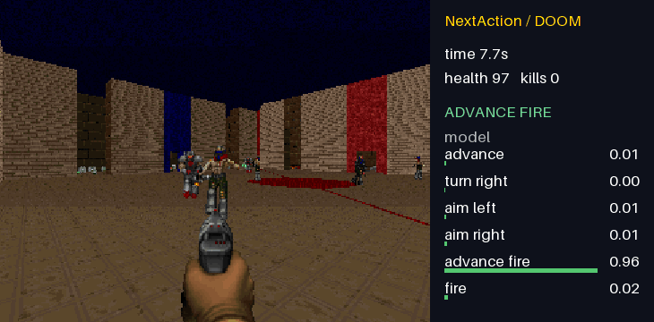

# Demo de Doom Deathmatch

O NextAction joga a arena **Deathmatch** do ViZDoom. Ele percorre o mapa, se afasta das paredes próximas, mira nos inimigos assim que eles aparecem e atira. O GIF grava o jogo real a cada dois tics (cerca de 17,5 quadros por segundo), incluindo o movimento entre as decisões do modelo.



A partir da raiz do repositório:

```powershell
pip install -e ".[demo]"
pip install "vizdoom>=1.3,<2"
python demos/doom/generate_data.py
nextaction train doom
nextaction evaluate doom
python demos/doom/play.py --gif demos/doom/doom.gif --record-from 270
```

Use `--agent teacher`, `--agent model-only` ou `--agent random` para comparação. `--seed` seleciona uma partida, `--max-tics` controla a duração da partida e `--record-from` corta do GIF a abertura sem ação, enquanto o agente continua jogando esse trecho. `--fps` controla a reprodução. O agente padrão envia as decisões de baixa confiança ao professor.

O professor usa os rótulos de objetos visíveis do ViZDoom, a profundidade no centro da tela, a saúde e a munição para escolher entre avançar, virar, mirar e atirar. O NextAction imita essas decisões. A dificuldade é definida como 1 para uma partida curta e fácil de assistir. Esta é uma demonstração de aprendizado por imitação, não um jogador genérico de Doom nem um modelo que lê pixels brutos.

As partidas de treino e de teste usam seeds separadas. Os CSVs são salvos em `data/external/`; o modelo treinado é salvo em `models/`.

Com 20 partidas de treino e 5 de teste, o modelo reproduziu todas as 580 decisões do professor no conjunto de teste (baseline da ação majoritária: 71,9%). Isso mede a imitação de um professor simples, não a habilidade geral em Deathmatch. Na partida gravada, separada do treino, o modelo fez três abates e sobreviveu aos 600 tics da execução.
