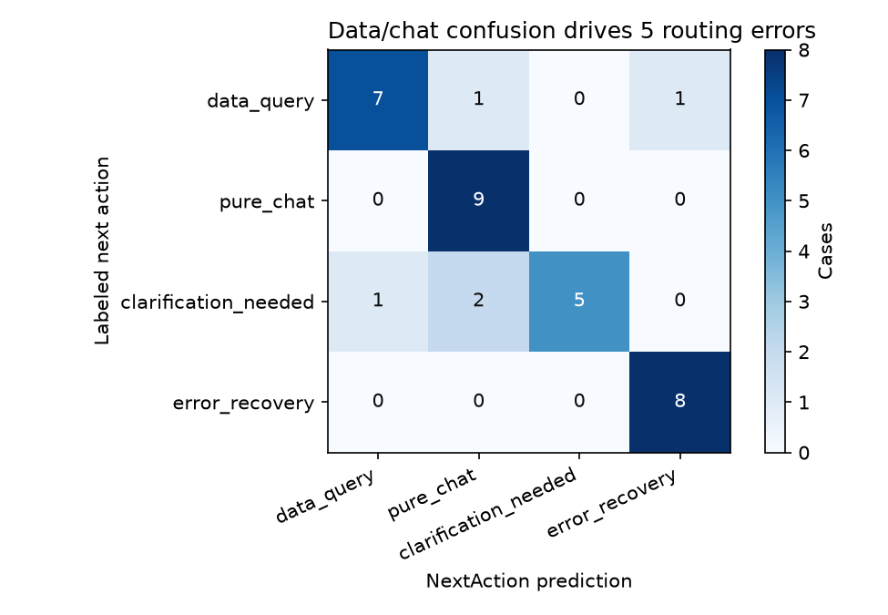
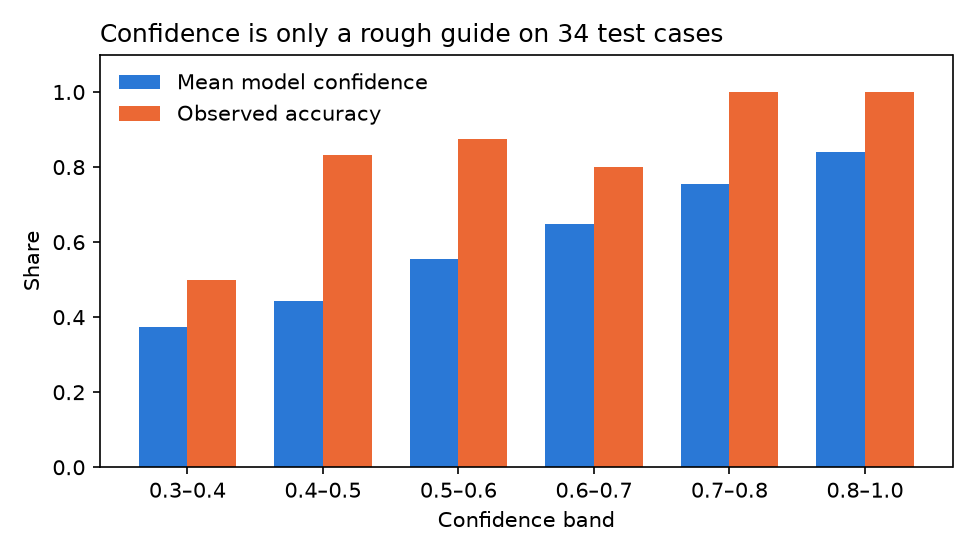

# Análise de erros do orquestrador de IA

Todas as 34 famílias de teste são sintéticas e separadas do treino. As contagens são contagens de casos, não estimativas de frequência em produção.

## Próximas ações incorretas

| Mensagem do usuário | Esperada | Prevista | Confiança | Revisão da política? | Roteador de palavras-chave |
| --- | --- | --- | ---: | --- | --- |
| Quais segmentos concentram churn? | `data_query` | `pure_chat` | 43,2% | não | `pure_chat` |
| O SQL anterior deu erro, agora mostre o ranking de produtos | `data_query` | `error_recovery` | 64,7% | não | `pure_chat` |
| Me mostre algo interessante | `clarification_needed` | `data_query` | 34,7% | sim | `pure_chat` |
| What should I analyze? | `clarification_needed` | `pure_chat` | 51,9% | não | `pure_chat` |
| Olhe esses valores para mim | `clarification_needed` | `pure_chat` | 41,7% | não | `pure_chat` |

## Confiança

| Faixa de confiança | Casos | Confiança média | Acurácia observada |
| --- | ---: | ---: | ---: |
| 0,3–0,4 | 2 | 37,3% | 50,0% |
| 0,4–0,5 | 12 | 44,4% | 83,3% |
| 0,5–0,6 | 8 | 55,4% | 87,5% |
| 0,6–0,7 | 5 | 64,9% | 80,0% |
| 0,7–0,8 | 5 | 75,5% | 100,0% |
| 0,8–1,0 | 2 | 83,9% | 100,0% |

Essas faixas são pequenas demais para uma afirmação forte sobre calibração. Os limiares de validação escolhem quando passar a rota para outro tomador de decisão; o resultado de revisão não entra no cálculo da acurácia.
