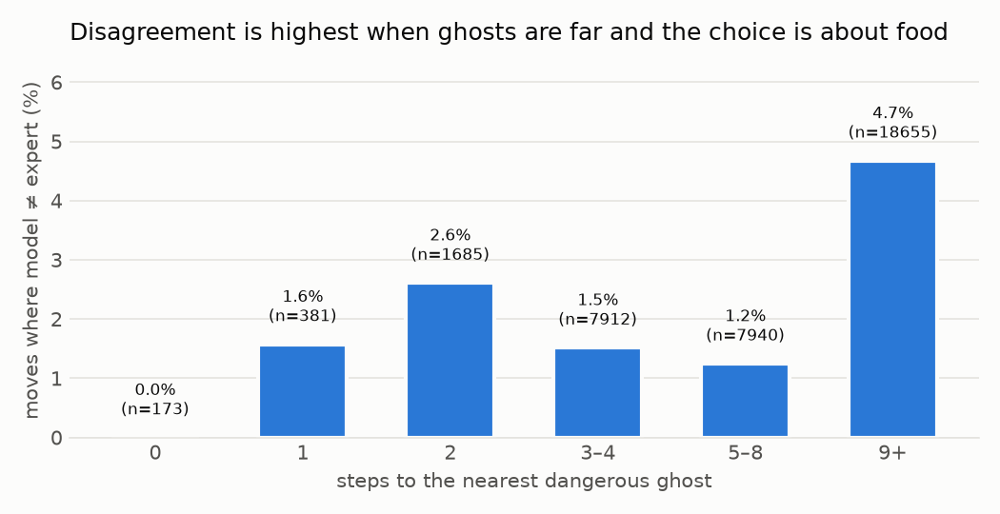
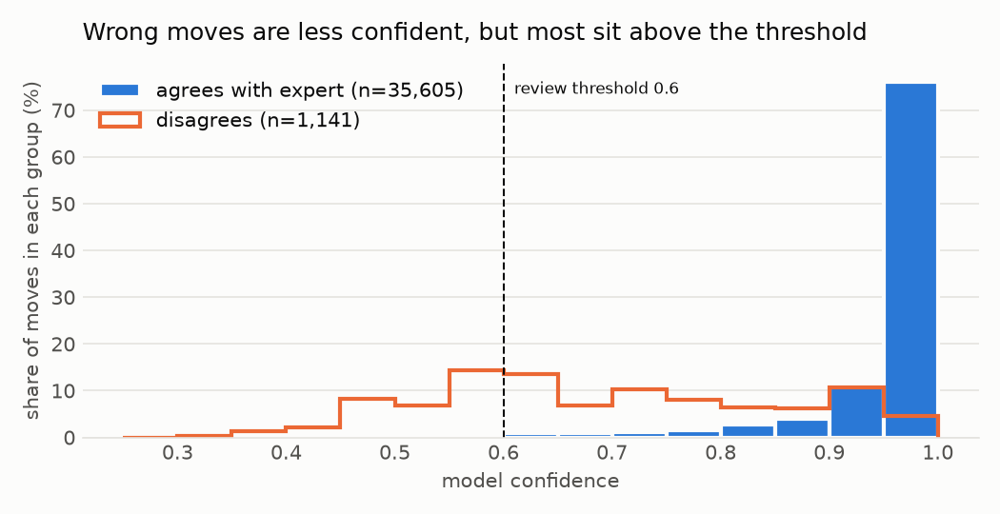
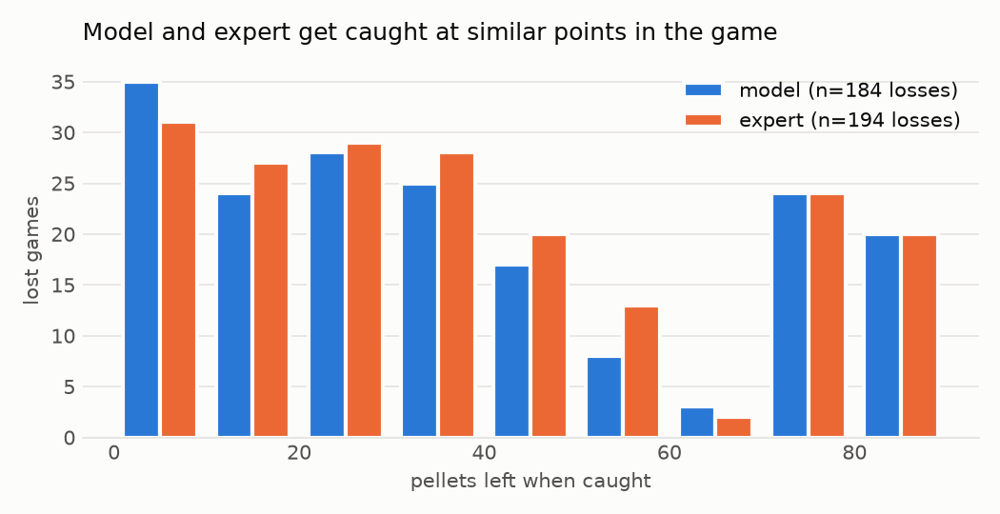

# Análise de erros do Pac-Man

Gerado por `python demos/pacman/analysis.py --games 300` nas sementes do benchmark 200000–200299. A cada movimento do modelo, o especialista também é consultado sobre o que faria; uma *discordância* é um movimento em que a escolha do modelo difere da do seu professor.

## Resumo

| | |
| --- | --- |
| Movimentos registrados | 36.746 em 300 partidas |
| O modelo discorda do especialista | 1.141 movimentos (3,1%) |
| Movimentos enviados ao especialista (confiança < 0,6) | 1.208 (3,3%) |
| Discordâncias capturadas pelo limiar | 33,3% |
| Movimentos revisados em que o especialista mudou o movimento | 31,5% |
| Confiança mediana: movimentos concordantes / discordantes | 0,99 / 0,69 |

## Onde o modelo discorda

| Situação | Movimentos | Discordância |
| --- | --- | --- |
| todos os movimentos | 36.746 | 3,1% |
| fantasma a 0–2 passos | 2.239 | 2,2% |
| fantasma a 3–8 passos | 15.852 | 1,4% |
| fantasma a 9+ passos | 18.655 | 4,7% |
| em um cruzamento (3+ movimentos livres) | 12.026 | 5,4% |
| em um corredor (≤2 movimentos livres) | 24.720 | 2,0% |
| pílula de poder ativa | 16.481 | 5,1% |
| sem pílula de poder | 20.265 | 1,5% |

**5,0% das discordâncias são empates**: o movimento do modelo e o do especialista estão igualmente perto da comida e igualmente longe dos fantasmas pelas próprias medidas do especialista, então a escolha do especialista ali é um desempate arbitrário que o modelo não consegue aprender. Excluindo os empates, o modelo discorda em 2,9% dos movimentos.

Discordâncias mais comuns (movimento do especialista → movimento do modelo):

| Especialista | Modelo | Movimentos |
| --- | --- | --- |
| right | left | 223 |
| down | up | 156 |
| up | down | 122 |
| left | right | 106 |
| left | down | 103 |
| right | down | 101 |

## A confiança sinaliza os movimentos ruins?

| Confiança | Movimentos | Discordância |
| --- | --- | --- |
| 0,25–0,50 | 276 | 50,4% |
| 0,50–0,60 | 621 | 38,8% |
| 0,60–0,70 | 875 | 26,7% |
| 0,70–0,80 | 1.199 | 17,5% |
| 0,80–0,90 | 2.546 | 5,7% |
| 0,90–1,00 | 31.229 | 0,6% |

O que um limiar de revisão diferente faria nesses mesmos movimentos (as partidas mudariam um pouco, já que movimentos revisados alteram a trajetória):

| Limiar | Movimentos enviados ao especialista | Discordâncias capturadas | Discordâncias deixadas para o modelo |
| --- | --- | --- | --- |
| 0,6 | 2,4% | 33,3% | 761 |
| 0,7 | 4,8% | 53,8% | 527 |
| 0,8 | 8,1% | 72,2% | 317 |
| 0,9 | 15,0% | 84,8% | 173 |

Medido rejogando todas as partidas com cada limiar:

| Limiar | Taxa de vitória | Movimentos decididos pelo especialista | Pontuação média |
| --- | --- | --- | --- |
| 0,6 | 39% | 3,3% | 3079 |
| 0,7 | 37% | 5,5% | 3038 |
| 0,8 | 37% | 8,7% | 3217 |
| 0,9 | 37% | 15,9% | 3174 |

Enviar mais movimentos ao especialista não vence mais partidas, porque o especialista não é mais forte que o modelo que ensinou (ele vence 35% das mesmas partidas). A revisão só compensa quando o revisor é melhor que o modelo; aqui ela basicamente troca um bom movimento por outro.

## Por que as partidas são perdidas

| | Modelo | Especialista |
| --- | --- | --- |
| Partidas vencidas | 116 | 106 |
| Partidas perdidas (capturado por um fantasma) | 184 | 194 |
| Passo mediano da captura | 100 | 98 |
| Mediana de pastilhas restantes na captura | 31 | 32 |

O movimento fatal de cada partida perdida pelo modelo:

| | Fração das derrotas |
| --- | --- |
| O Pac-Man já estava encurralado (todo movimento livre ao lado de um fantasma) | 100,0% |
| Decidido pelo modelo | 0,0% |
| Decidido pelo especialista (revisão) | 100,0% |
| O especialista teria escolhido o mesmo movimento | 100,0% |
| Havia um fantasma a 0–2 passos antes do movimento | 100,0% |
| O Pac-Man estava em um corredor (≤2 movimentos livres) | 100,0% |

Resultados nas mesmas sementes:

| | Especialista venceu | Especialista perdeu |
| --- | --- | --- |
| **Modelo venceu** | 57 | 59 |
| **Modelo perdeu** | 49 | 135 |
