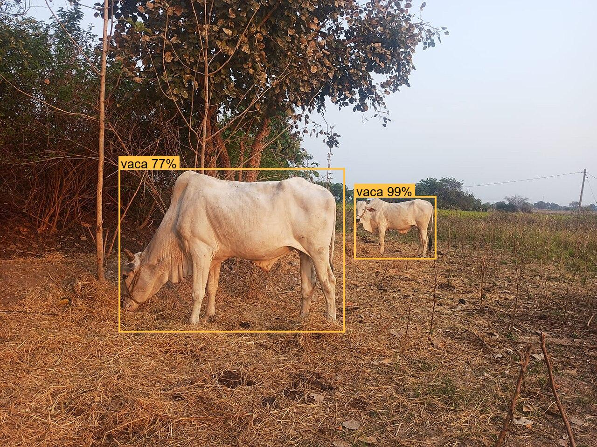
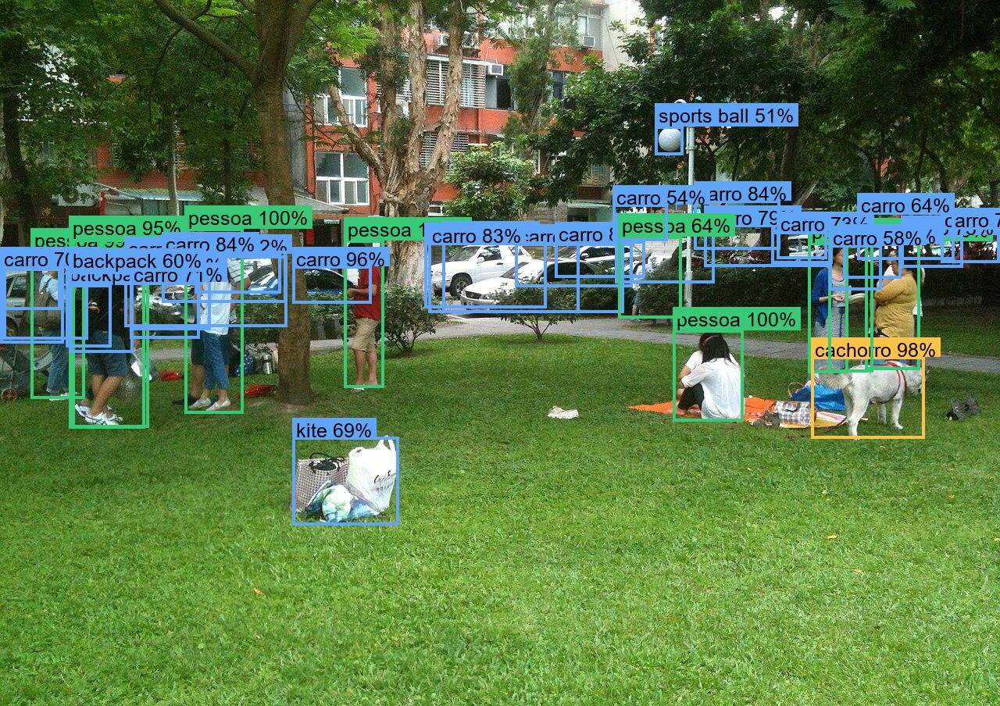
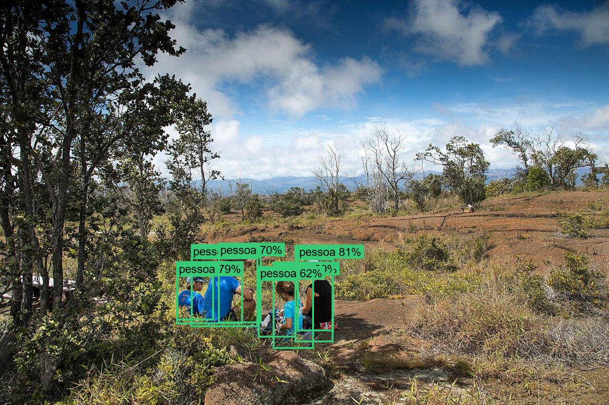
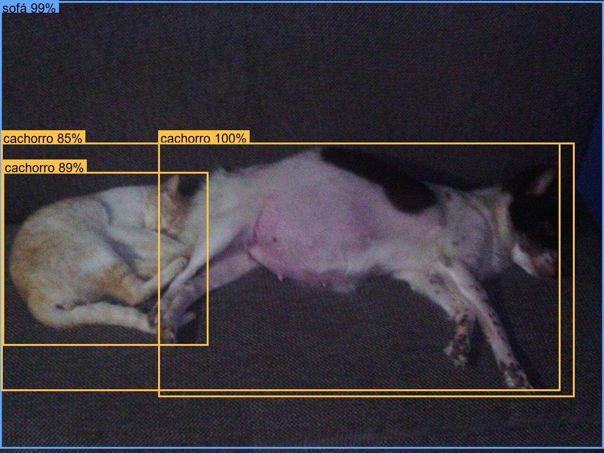

# Identificação de objetos em imagens

O comando `inspect-image` recebe uma imagem e detecta pessoas, animais e outros objetos. Ele salva uma cópia com caixas e rótulos e imprime JSON com classe, confiança, coordenadas e contagens por grupo.

```powershell
pip install -e ".[vision]"
nextaction inspecionar-imagem caminho/para/foto.jpg
nextaction inspect-image caminho/para/foto.jpg --output resultados/foto_marcada.png --threshold 0.6
```

Por padrão, a imagem marcada é salva ao lado da original com sufixo `_detected.png`. O primeiro uso baixa os pesos do modelo [YOLOS Tiny](https://huggingface.co/hustvl/yolos-tiny) do Hugging Face; depois a inferência é local. A foto não é enviada ao Hub. O modelo detecta classes do COCO, incluindo `person`, `cat`, `dog`, `bird`, veículos e objetos cotidianos. Os rótulos mais comuns aparecem em português sobre a imagem; o JSON também preserva o nome original em inglês.

Exemplo resumido de saída:

```json
{
  "counts": {"people": 0, "animals": 2, "objects": 0},
  "detections": [
    {"label": "cat", "label_pt": "gato", "category": "animals", "confidence": 0.988,
     "box": {"xmin": 151, "ymin": 138, "xmax": 432, "ymax": 342}}
  ]
}
```

Esse fluxo usa um detector de objetos pré-treinado, separado do classificador de próxima ação do NextAction. Os resultados dependem da foto, do limiar de confiança e das classes que o modelo conhece; não detectar algo não prova que ele esteja ausente.

## Exemplos

Quatro fotos gratuitas do Wikimedia Commons (domínio público ou CC0), com o limiar padrão de 0,5. As imagens abaixo são a saída anotada do comando: verde para pessoas, amarelo para animais, azul para objetos.

| Foto | Pessoas | Animais | Objetos | O que observar |
| --- | --- | --- | --- | --- |
| Vacas no campo | 0 | 2 | 0 | as duas vacas encontradas, uma com 99% e outra com 77% |
| Pessoas e um cachorro no parque | 10 | 1 | 29 | o cachorro com 98%; a maioria das pessoas encontrada; carros estacionados contados várias vezes |
| Piquenique em família | 8 | 0 | 0 | cerca de cinco pessoas, contadas como oito por causa de caixas sobrepostas |
| Gato e cachorro no sofá | 0 | 3 | 1 | o gato é rotulado como cachorro, e o cachorro ganha duas caixas |









O pequeno modelo YOLOS Tiny é rápido e roda na CPU, mas os exemplos mostram seus limites: ele pode confundir animais parecidos e desenhar várias caixas no mesmo objeto, o que infla as contagens. Trate as contagens como estimativas e confira a imagem anotada quando o número importar.

Créditos das fotos (todas de uso livre, sem exigência de atribuição): [vacas](https://commons.wikimedia.org/wiki/File:Cows_in_a_Field.jpg) por KaanaveniSaikiran (CC0); [parque](https://commons.wikimedia.org/wiki/File:People_Talking_on_Grass_with_Dog_at_Minsheng_Park_20150503.jpg) por 玄史生 (CC0); [piquenique](https://commons.wikimedia.org/wiki/File:Family_picnic_Kulanaokuaiki_Campground_NPS_Photo_Janice_Wei_%2843852400890%29.jpg) por Janice Wei, Hawai‘i Volcanoes NPS (domínio público); [gato e cachorro](https://commons.wikimedia.org/wiki/File:Cat_and_dog_sleeping_together.jpeg) (domínio público).
